# HorizonTechX Secure Coding Review

Educational Flask application demonstrating secure coding practices.

## Technology
- Python
- Flask
- SQLite
- Werkzeug
- unittest

## Security Controls
- Parameterized SQL queries
- Password hashing
- Input validation
- Generic authentication errors
- Request size limit
- Debug mode disabled
- Localhost-only binding

## Setup
```bash
python3 -m venv .venv
source .venv/bin/activate
pip install -r requirements.txt
python app.py
```

Open http://127.0.0.1:5000/

## Run Tests
```bash
python -W default -m unittest discover -s tests -v
```

See SECURITY_AUDIT_REPORT.md for findings, fixes, tests and limitations.


## 📸 Task 3 — Screenshot Evidence

### Screenshot 1
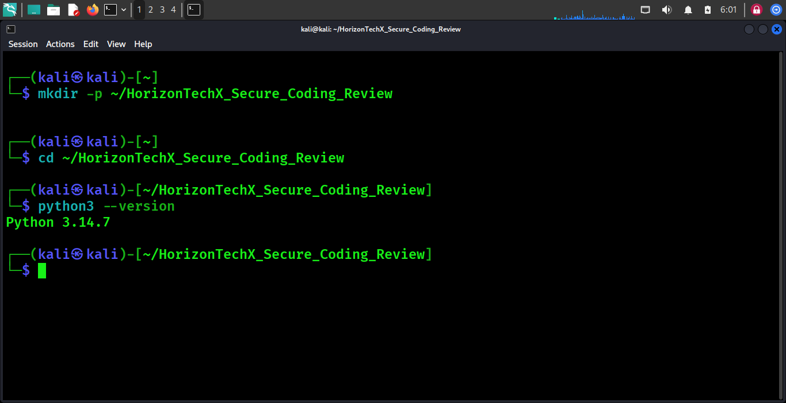

### Screenshot 2
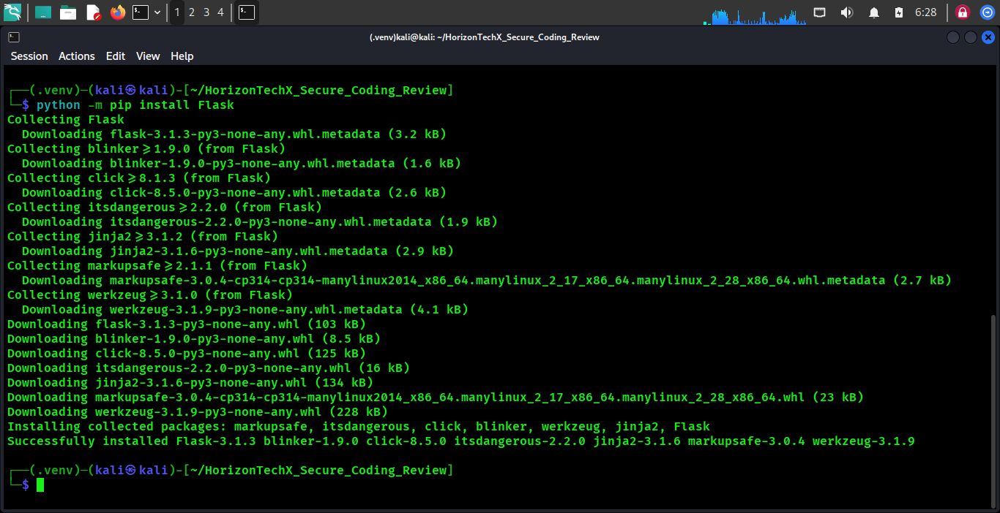

### Screenshot 3
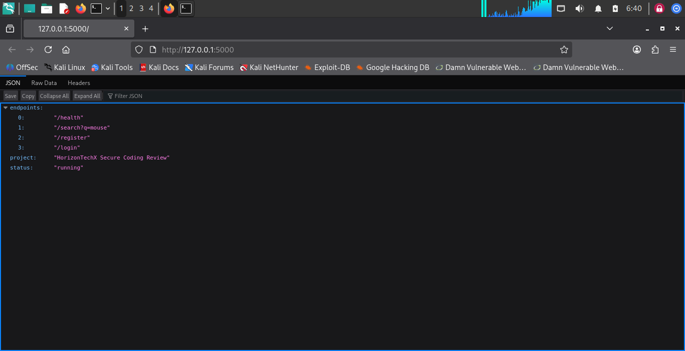

### Screenshot 4
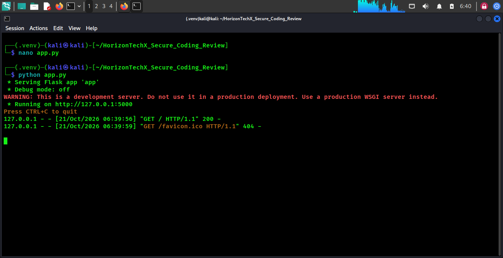

### Screenshot 5
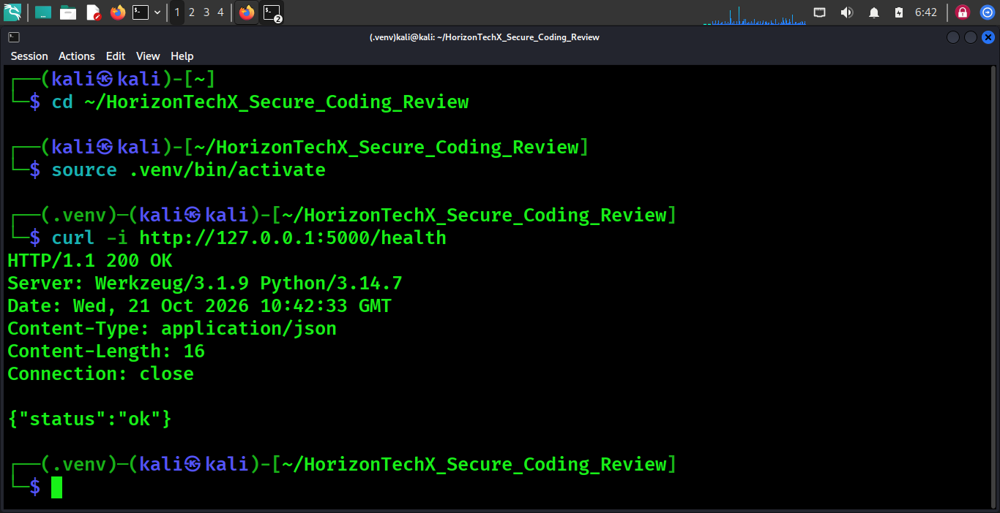

### Screenshot 6
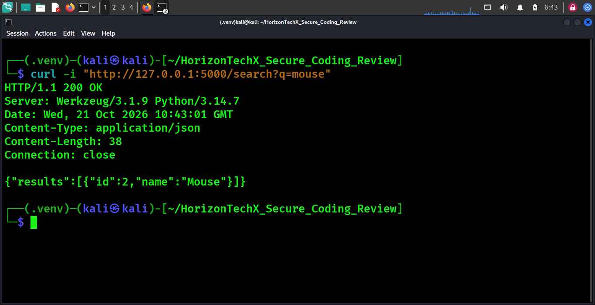

### Screenshot 7
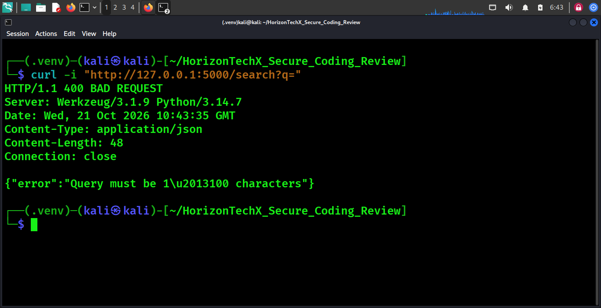

### Screenshot 8
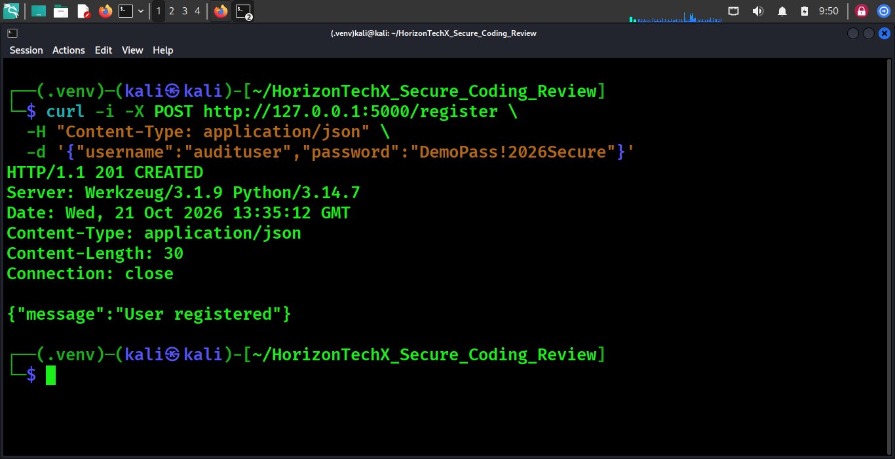

### Screenshot 9
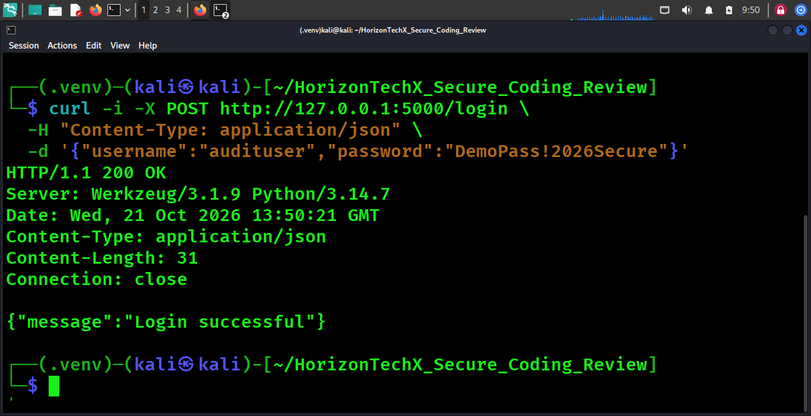

### Screenshot 10
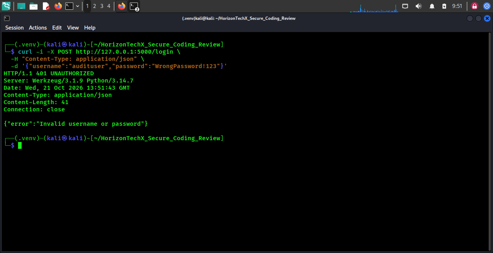

### Screenshot 11
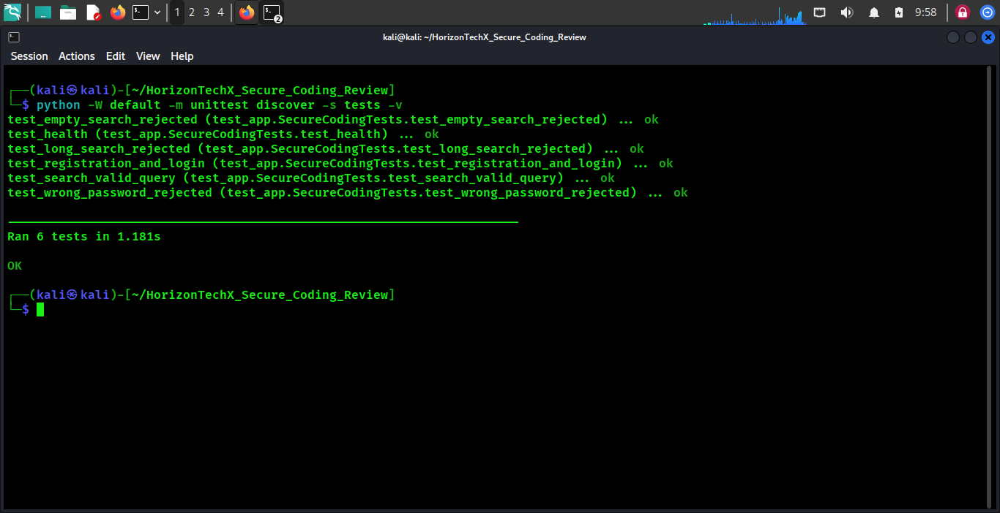

### Screenshot 12
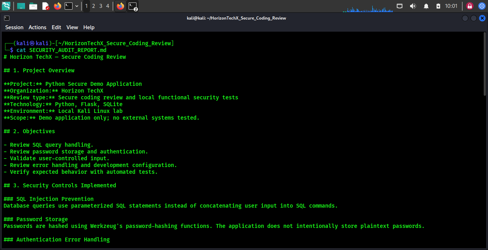

### Screenshot 13
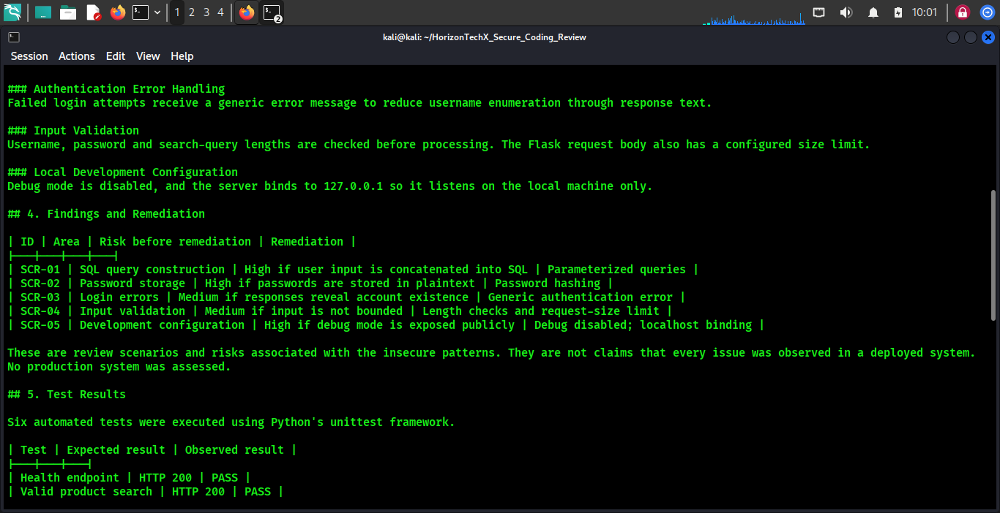

### Screenshot 14
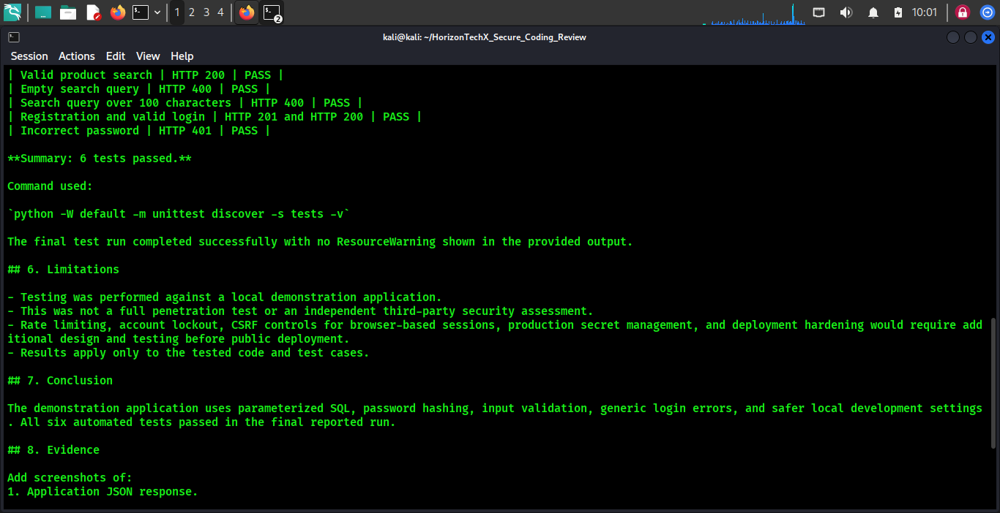

### Screenshot 15
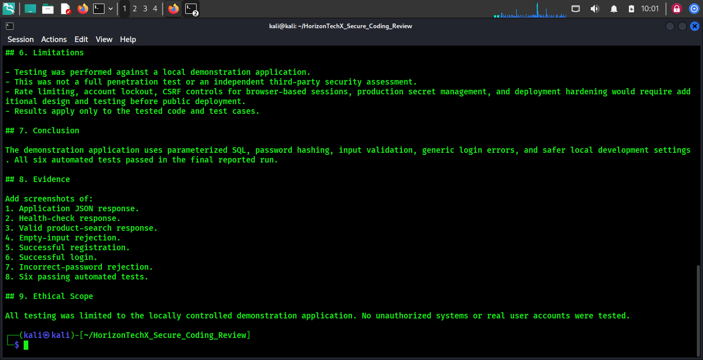

### Screenshot 16
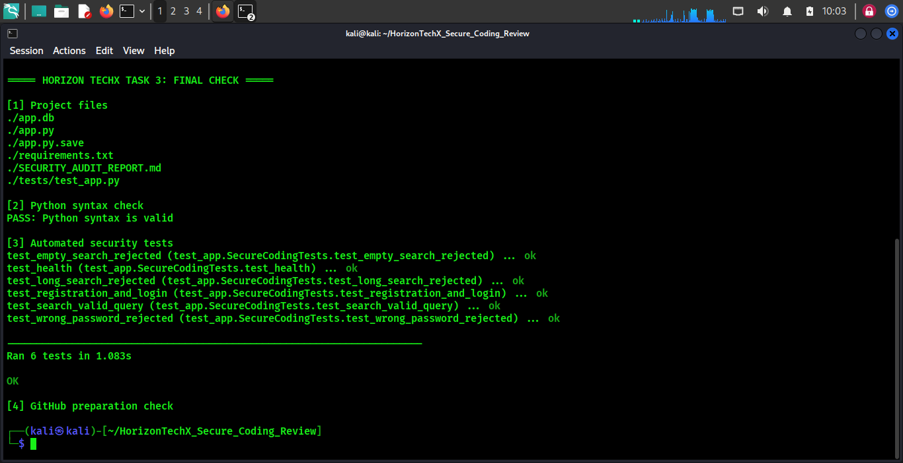

### Screenshot 17
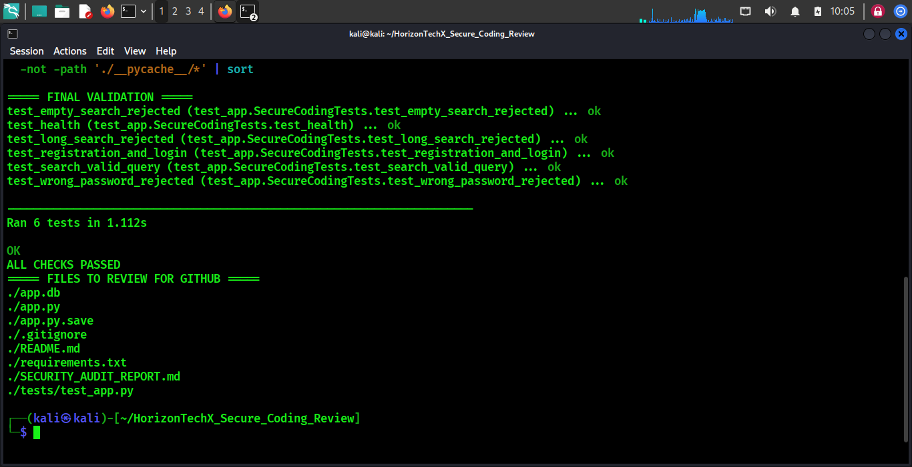


## Disclaimer
Educational local demo only; not production-ready.
